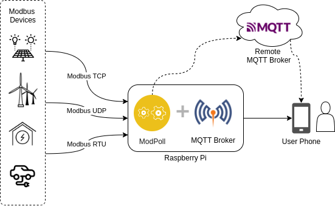
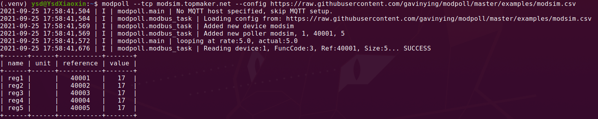
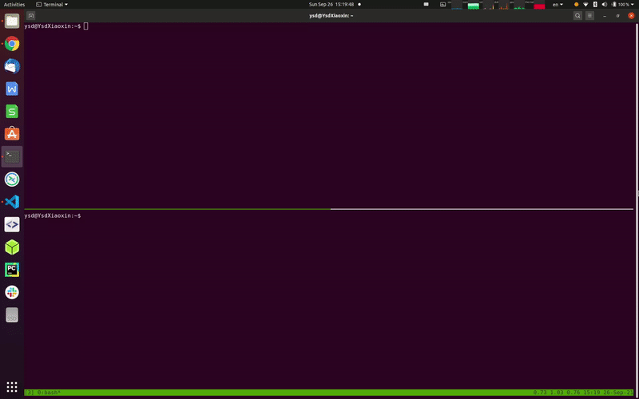

> **2.x development branch.** This checkout accepts WoT TM/TD JSON. CSV remains supported on the 1.x `main` branch. The first functional preview is `2.0.0a1`: install it explicitly with `pip install "modpoll[serial]==2.0.0a1"`. Stable 1.x remains available with `pip install "modpoll<2"`. For development, run `mise install` and `mise exec -- poetry install --all-extras`, then prefix the examples below with `mise exec -- poetry run`.

# Modpoll - A New Command-line Tool for Modbus and MQTT

[](https://img.shields.io/github/v/release/top-maker/modpoll)
[](https://github.com/top-maker/modpoll/actions/workflows/main.yml?query=branch%3Amain)
[](https://img.shields.io/github/license/top-maker/modpoll)
[](https://pepy.tech/project/modpoll)


> Learn more about *modpoll* usage at [documentation](https://top-maker.github.io/modpoll) site.

## Motivation

The idea for creating this tool originated from my need to efficiently check new devices during site surveys. These surveys are often time-constrained and space-limited, with on-site work adding to the pressure. In such situations, a portable Swiss Army knife toolkit becomes a valuable companion.

This tool can be easily deployed on a Raspberry Pi or similar embedded devices, polling data from a Modbus network or connected devices. Users can choose to log the data locally or publish it to an MQTT broker for further troubleshooting.

The MQTT broker can be set up either on the same Raspberry Pi or in the cloud. Once data is successfully published, users can subscribe to the relevant MQTT topics and conveniently view the data on their smartphones.

<p align="center">
  
</p>

Moreover, you can also run this tool continuously on a server as a Modbus-MQTT gateway, i.e. polling from local Modbus devices and forwarding data to a centralized cloud service.

In fact, *modpoll* helps to bridge between the traditional field-bus world and the new IoT world.

> 💡 **Tips:** This tool is designed to be a standalone executable application, which works out-of-the-box on Linux/macOS/Windows. If you are looking for a Modbus python library, please consider the following great open-source projects, [pymodbus](https://github.com/riptideio/pymodbus) or [minimalmodbus](https://github.com/pyhys/minimalmodbus)


## Feature

- Support Modbus RTU/TCP/UDP devices
- Show polling data for local debugging, like a typical modpoll tool
- Publish polling data to MQTT broker for remote debugging, especially on smart phone
- Export polling data to local storage for further investigation
- Provide docker solution for continuous data polling use case


## Installation

This tool tested on Python 3.10+ (Ubuntu 22.04+ or equivalent), the package is available in the [Python Package Index](https://pypi.org/), users can easily install it using `pip` or `pipx`. Ubuntu 20.04 and Python 3.8 are no longer supported.

### Using PIP

Install *modpoll* using the following command,

```bash
pip install "modpoll==2.0.0a1"
```

Optionally, [pyserial](https://pyserial.readthedocs.io/) library can be installed for Modbus-RTU communication,

```bash
pip install 'modpoll[serial]==2.0.0a1'
```

Upgrade the tool via the following command,

```bash
pip install -U --pre "modpoll<3"
```

### On Windows

It is recommended to use `pipx` for installing *modpoll* on Windows, refer to [here](https://pypa.github.io/pipx/installation/) for more information about `pipx`.

Once `pipx` installed, you can run the following command in a Command Prompt terminal.

```PowerShell
pipx install "modpoll==2.0.0a1"
```

Upgrade the tool via the following command,

```PowerShell
pipx upgrade modpoll
```

## Quickstart

Use the public Modbus TCP simulator at `modsim.topmaker.net:502` for a quick test:

```bash
modpoll --once \
  --tcp modsim.topmaker.net --tcp-port 502 \
  --config examples/modsim.tm.json
```

### Run a local simulator

Start a local [modsim](https://github.com/top-maker/modsim) server, then use the provided configuration to read its sample data:

```bash
docker run --rm -p 5020:5020 topmaker/modsim:latest
```

In another terminal, run:

```bash
modpoll --once \
  --tcp 127.0.0.1 --tcp-port 5020 \
  --config examples/modsim.tm.json
```

The JSON examples are included in this checkout. A public URL containing the same JSON format is also accepted.

<p align="center">
  
</p>

> the modsim code is also available [here](https://github.com/top-maker/modsim)

### Modbus ASCII and framers

- Serial transports: use `--serial PORT --framer ascii` (alias: `--rtu` still accepted); pyserial URLs such as `socket://host:port` and `rfc2217://host:port` work for serial-over-TCP tunnels.
- Serial supports framers `ascii` and `rtu` (pymodbus defaults to RTU if `--framer default`). Binary framer is no longer supported in pymodbus 3.9+.

### Prepare a WoT configuration

Use [examples/modsim.tm.json](examples/modsim.tm.json) for the simulator model or
[examples/modsim.td.json](examples/modsim.td.json) for a concrete TCP description.
Both preserve the four original blocks and 37 output references. `--unit-id`
overrides each model's optional root `modv:unitID` (fallback 1); a concrete TD's forms must agree with it.
The existing transport, polling, output and MQTT arguments remain available.

See [the executable contract](packages/modpoll-wot/CONTRACT.md) for field
mapping, access flags, byte order, multiplier semantics and supported limits.
The configuration loader rejects CSV and reports invalid model fields before
polling. Each model describes one device; use multiple `--config` paths for
multiple devices. Give each model a unique `title`, which is the output device name.

Physical RS485 polling has also been verified by the maintainer with an Eastron
meter (2026-10-28). See [validation](docs/validation.rst) for the evidence scope and
[contributed mappings](contrib/README.md) for vendor references.

For a complete local simulator/MQTT demonstration, use the repository's
[Docker Compose example](examples/README.md).

### Poll local device (modsim)

To run the simulator locally, start the container:

```bash
docker run --rm -p 5020:5020 topmaker/modsim
```

It will create a virtual Modbus TCP device running at `localhost:5020`, and you can open a new terminal, poll the virtual device using *modpoll* tool,

```bash
modpoll \
  --tcp localhost \
  --tcp-port 5020 \
  --config examples/modsim.tm.json
```

> Use `sudo` before the docker command if you want to use the standard port `502`.

```bash
sudo docker run --rm -p 502:5020 topmaker/modsim
```

In a new terminal,

```
modpoll \
  --tcp localhost \
  --config examples/modsim.tm.json
```

### Publish data to MQTT broker

This is a useful function of this new *modpoll* tool, which provides a simple way to publish collected Modbus data to MQTT broker, so users can view data from a smart phone via a MQTT client.

The following example uses a public MQTT broker `broker.emqx.io` for test purpose. You can also set up your own MQTT broker locally using [mosquitto](https://mosquitto.org/download/).

```bash
modpoll \
  --tcp 127.0.0.1 --tcp-port 5020 \
  --mqtt-host broker.emqx.io \
  --config examples/modsim.tm.json
```

With successful data polling and publishing, you can subscribe the default data topic `modpoll/modsim01/data` on the same MQTT broker `broker.emqx.io` to view the collected data.

The MQTT topics can be customized by providing the following arguments,

  - `mqtt-publish-topic-pattern`
  - `mqtt-subscribe-topic-pattern`
  - `mqtt-diagnostics-topic-pattern`

See [document](https://top-maker.github.io/modpoll/v2/usage.html#Named%20Arguments) for details.


<p align="center">
  
</p>


### Write registers via MQTT publish

The *modpoll* tool will subscribe to the topic `modpoll/{{device_name}}/set` by default once it successfully connected to MQTT broker, user can write device register(s) via MQTT publish,

- To write a single holding register (address at `40001`)

  ```json
  {
    "object_type": "holding_register",
    "address": 40001,
    "value": 12
  }
  ```

- To write multiple holding registers (address starting from `40001`)

  ```json
  {
    "object_type": "holding_register",
    "address": 40001,
    "value": [12, 13, 14, 15]
  }
  ```

A register array is written with FC16 and must contain 1–123 unsigned 16-bit values within the address range. Invalid, oversized, malformed, ambiguous, or retained write messages are ignored and logged. Brokers may clear the retained flag on live forwarding, so configure the broker not to retain commands on the `set` topic; QoS does not make a write exactly-once.

When a sample is invalid in a poll cycle, modpoll omits it from MQTT output and writes `null` for that reference in the JSON snapshot. JSON snapshots from multiple configuration files are combined and replaced atomically. When `--timestamp` is enabled, the timestamp is the start time of the poll cycle in Unix seconds, not the time each individual value was read.


## Run with docker

A docker image has been provided for user to directly run the tool without local installation,

  ```bash
  docker run --rm topmaker/modpoll:2.0.0a1
  ```

It shows the version of the tool by default.

On Linux, host networking connects the container to a simulator on the host.
Mount the JSON configuration into the container; ``--daemon`` suppresses tables.

If you want to load a local configure file, you need to mount a local folder onto container volume,
for example, if the child folder `examples` contains the config file `modsim.tm.json`, we can use it via the following command,

  ```bash
  docker run --rm --network host -v "$(pwd)/examples:/app/examples:ro" topmaker/modpoll:2.0.0a1 \
    modpoll -d \
      --tcp 127.0.0.1 --tcp-port 5020 \
      --config /app/examples/modsim.tm.json
  ```


## Example Use Cases

- Connect to Modbus TCP device

  ```bash
  modpoll \
    --tcp 192.168.1.10 \
    --config examples/modsim.tm.json
  ```

- Connect to Modbus serial device

  ```bash
  modpoll \
    --serial /dev/ttyUSB0 \
    --serial-baud 9600 \
    --config examples/modsim.tm.json
  ```

- Connect to Modbus TCP device and publish data to MQTT broker

  ```bash
  modpoll \
    --tcp 127.0.0.1 --tcp-port 5020 \
    --mqtt-host broker.emqx.io \
    --config examples/modsim.tm.json
  ```

- Connect to Modbus TCP device and export a local JSON snapshot

  ```bash
  modpoll \
    --tcp 127.0.0.1 --tcp-port 5020 \
    --export data.json \
    --config examples/modsim.tm.json
  ```

- Connect to Modbus TCP devices using multiple config files

  ```bash
  modpoll \
    --tcp 127.0.0.1 --tcp-port 5020 \
    --config examples/modsim.tm.json examples/modsim2.tm.json
  ```


> Refer to the [documentation](https://top-maker.github.io/modpoll) site for more details about the configuration and examples.

> *If you find this tool useful, please support us by starring 🌟 our repository to encourage further improvements.*

## Credits

The implementation of this project is heavily inspired by the following two projects:
- https://github.com/owagner/modbus2mqtt (MIT license)
- https://github.com/mbs38/spicierModbus2mqtt (MIT license)

Thanks to Max Brueggemann and Oliver Wagner for their great work.


## License

MIT © 2021-2026, Ying Shaodong
